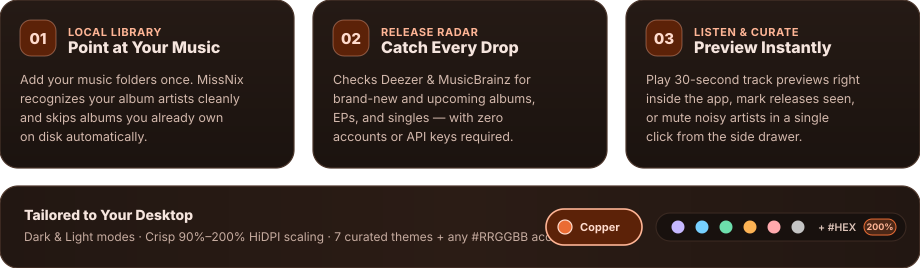
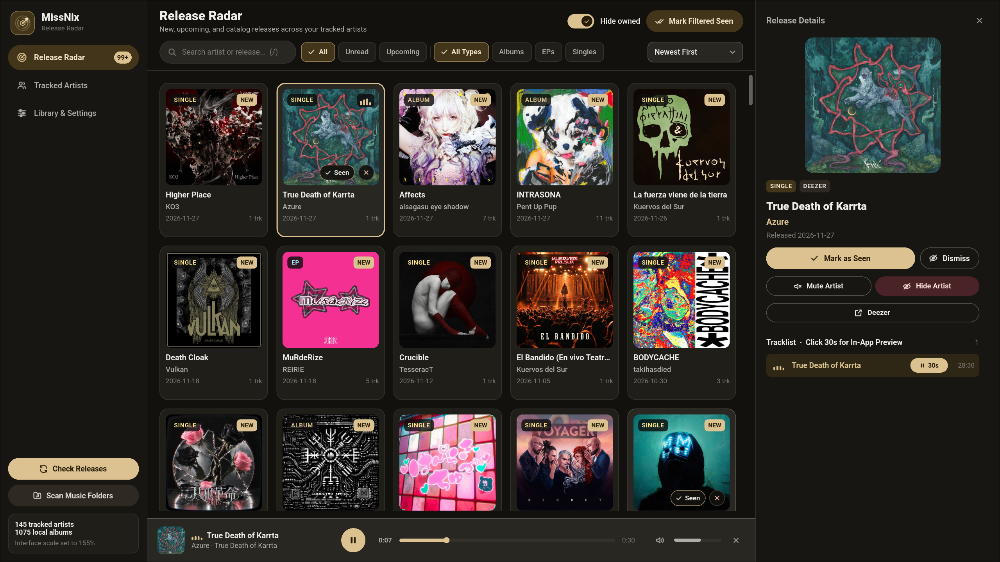
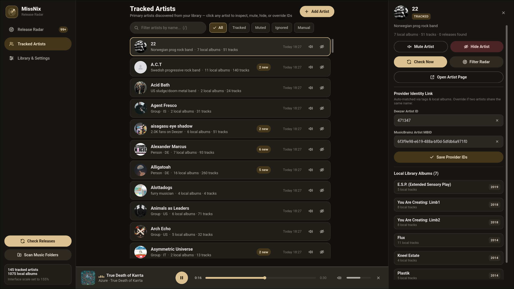
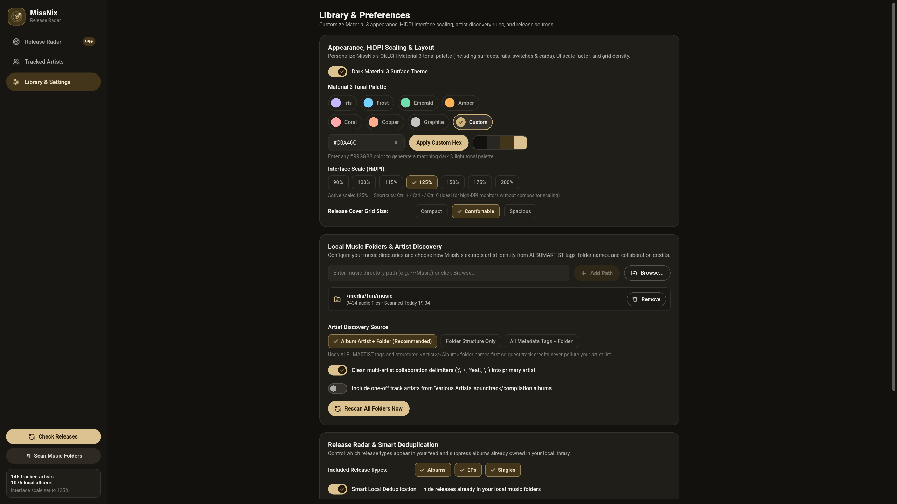

<div align="center">


<br />

[](https://github.com/Irgendeinwer/MissNix/actions/workflows/ci.yml)
[](https://github.com/Irgendeinwer/MissNix/releases)
[](flake.nix)
[](https://github.com/Irgendeinwer/MissNix/releases)
[](LICENSE)

</div>

**MissNix** scans your local music folders, builds a list of the artists in your library, and checks **Deezer** and **MusicBrainz** for new and upcoming albums, EPs, and singles. No accounts, subscriptions, or API keys required.

<div align="center">
  
</div>

---

## Features

- **Local folder sync:** Watches your music directories (`FLAC`, `MP3`, `Opus`, `Ogg`, `M4A`, `WAV`, `AIFF`, `WavPack`), keeps your artist list up to date, and hides albums you already own on disk.
- **Artist tag cleanup:** Splits collaboration credits into individual artists without breaking names like `Tyler, The Creator`, `Black Country, New Road`, or `AC/DC`. You can also mute or hide any artist in one click.
- **Release radar:** Shows new, unread, and upcoming releases in a cover grid with search and filters for albums, EPs, and singles.
- **30-second track previews:** Play track previews from the release drawer or docked mini-player without leaving the app.
- **Themes and scaling:** Choose dark or light mode, 7 built-in palettes, or a custom `#RRGGBB` accent seed. Accent and swatch lightness are adjusted for readability; the settings offer `90%`–`200%` UI scaling.
- **Headless CLI:** Run scans, check for new drops, emit JSON status output, and send desktop notifications from a terminal or systemd timer.

---

## Screenshots

Click a screenshot to open the original image.

[](assets/docs/screenshots/radar.png)

<details>
<summary>More screenshots: Artists and Settings</summary>

**Tracked Artists**

[](assets/docs/screenshots/artists.png)

**Library & Preferences**

[](assets/docs/screenshots/settings.png)

</details>

---

## Install & Run

### Prebuilt Linux Downloads

Grab the latest `.AppImage` or `.tar.gz` archive from [**Releases**](https://github.com/Irgendeinwer/MissNix/releases):

```bash
chmod +x missnix-v*-linux-x86_64.AppImage
./missnix-v*-linux-x86_64.AppImage
```

### Nix / NixOS

Run directly without installing:

```bash
nix run github:Irgendeinwer/MissNix
```

Or add MissNix to your `flake.nix`:

```nix
{
  inputs.missnix = {
    url = "github:Irgendeinwer/MissNix";
    inputs.nixpkgs.follows = "nixpkgs";
  };
}
```

Then install it in your **NixOS** configuration via `environment.systemPackages` or the NixOS module:

```nix
{ inputs, pkgs, ... }:
{
  environment.systemPackages = [
    inputs.missnix.packages.${pkgs.stdenv.hostPlatform.system}.default
  ];

  # Or using the NixOS module instead:
  # imports = [ inputs.missnix.nixosModules.default ];
  # programs.missnix.enable = true;
}
```

Or in **Home Manager** (with optional scheduled checks and desktop notifications):

```nix
{ inputs, ... }:
{
  imports = [ inputs.missnix.homeManagerModules.default ];

  programs.missnix = {
    enable = true;
    musicDirs = [ "/home/alice/Music" ];
    defaultAccentHex = "#E9B143";
    timer.enable = true;
  };
}
```

### Build from Source

```bash
cargo run --release
```

---

## Command-Line Options

Running `missnix` with no flags launches the desktop app. Pass flags to run headlessly or override startup settings:

```text
missnix [OPTIONS]

  --scan <FOLDER>   Add and scan a local music folder
  --accept-empty-folders  Confirm previously indexed folders are intentionally empty (with --scan)
  --check           Check tracked artists for new releases
  --notify          Send a desktop notification when --check finds new drops
  --status          Print tracked artist and unread release counts
  --json            Emit structured JSON output in headless mode
  --scale <PCT>     Set interface scale percentage (75..250, e.g. 125 or 150)
  --db <FILE>       Use a custom database file path
  -h, --help        Show help
  -V, --version     Show version
```

---

## Keyboard Shortcuts

| Shortcut | Action |
| :--- | :--- |
| `/` | Focus the search bar in Release Radar or Tracked Artists |
| `Space` | Play or pause the active 30-second track preview |
| `Esc` | Close the inspector, expanded navigation, or Add Artist bar |
| `Ctrl + R` | Check all tracked artists for new releases |
| `Ctrl + =` / `Ctrl + -` | Increase or decrease interface scale |
| `Ctrl + 0` | Reset interface scale to `100%` |

---

## Contributing & Architecture

Architecture notes, module layout, build checks, and contributor guidelines are in [`AGENTS.md`](AGENTS.md).

## License

Released under the [MIT License](LICENSE).
